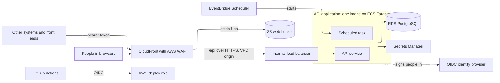

# Application template design

The architecture and development practices for applications built with AI coding assistants. Applications have a web interface, an API running in a container and a PostgreSQL database, hosted on AWS, with source code and pipelines in GitHub.

Settings that vary by owner or account, rather than by design, are kept out of this design. They include the versions of languages, runtimes and the database, the permitted regions, resource tagging, log retention and the accessibility level. The template reads them as configuration, and their defaults are listed in [configuration-defaults.md](configuration-defaults.md).

## API consumers

- Every interface is a client of the API: the application's own web interface, other systems, and any separate front end built for external users.
- Features are built as API operations first, so a new interface can be added, or an existing one replaced, without changing business logic.
- API paths name the resource (`/api/v1/customers/{id}`, `/api/v1/accounts/{id}`), never the caller. Who may call each operation is set by the caller's identity and roles.
- Other systems reach the API through the application's CloudFront and AWS WAF. The API validates every token itself, so a gateway can be added later without changing the application.

## Web interface

- A React single-page app built with Vite and served as static files from S3 through CloudFront.
- The API signs people in as a backend-for-frontend, using the authorisation code flow with PKCE as a confidential client. The browser holds only an HttpOnly session cookie and never receives a token.
- One API module for every call to the API, using a client generated from the API's OpenAPI description.
- A shared component kit built on Tailwind and Radix primitives, extended rather than replaced.
- Route guards decide only what is shown. The API enforces access.
- No business rules in the web interface.
- A strict Content Security Policy set at CloudFront, allowing connections only to the application's own address.
- The environment name read from a `config.json` written at deployment, so the same build is deployed to every environment. The web interface needs no identity settings.
- Timestamps shown in the browser's time zone, in date and time formats each application sets for its users and screens.
- An environment banner on every non-production environment.
- A confirmation step before any action that cannot be undone.
- Accessible to the level in the configuration defaults, with tables that have captions and announce their sort order.

## API

- Python with FastAPI.
- Layered: routes handle HTTP and own transactions; services hold business logic with no HTTP concerns; repositories hold all database access; schemas define requests and responses.
- All business logic sits in the API, especially logic that is complex or must be applied consistently. Outcomes are calculated and stored by the API, with rule thresholds held in versioned configuration.
- Every request is validated, including value ranges.
- Timestamps are held in UTC and exchanged as ISO 8601 with an offset. Rules that depend on the local day use a configured business time zone.
- Versioned under `/api/v1`, with the generated OpenAPI document as the contract. Breaking changes need a new major version.
- One error format for every response, with an error code, details, and correlation and request IDs.
- A correlation ID carried from the browser through the API into the logs and audit records.
- Structured JSON logs with no personal information. Who acted is recorded in the audit trail, linked to the logs by the correlation ID.
- An unauthenticated `/api/health` endpoint that checks the database.

## Identity and access

- Any OpenID Connect provider, configured by its discovery URL. Entra ID is the default for internal users. An application with external users, such as customers or people from other companies, adds a second issuer, by default Entra External ID.
- Web sign-in is held in a server-side session in the database, ended after a period of inactivity or a maximum time. State-changing requests made with the session cookie carry a cross-site request forgery token.
- One application registration per issuer, as a confidential client with a certificate held in Secrets Manager. It defines the app roles. Each consumer system has its own registration.
- Permissions come from app roles in the token and are checked on every route. There is no role hierarchy.
- Internal, external and system roles are kept separate. Other systems use the client credentials flow.
- A consumer acting for an external user passes that user's own token for anything about them, and each application defines which records external users can see, checked in the API's service layer.
- Directory lookups, where an application needs them, go through the API.
- Every deployed environment validates real tokens and refuses to start without identity settings. Developers' machines use a local mock identity provider standing in for each issuer, through the same sign-in and validation code.

## Data

- PostgreSQL on Amazon RDS, with the master password managed by RDS in Secrets Manager.
- The application connects as its own least-privilege user over verified TLS. Only the migration step can change the schema.
- Schema changes are versioned migration scripts (Alembic), run by the pipeline as a one-off ECS task before each service update. An ECS task is one running copy of a container. The API runs as long-lived tasks, and migrations and scheduled jobs run as tasks that exit when they finish.
- Conventions: UUID keys, `timestamptz` timestamps in UTC, `date` for calendar dates, soft delete, JSONB for documents and check-constrained enums.
- An append-only audit trail records who changed what, with before and after state and a reason for corrections. Records that need their full history also keep a revision table. Audit records may hold personal information because they sit in the same database as the records they describe, with the same access control, encryption and retention.
- Data leaves the application only through its API or through a defined export that records each run. There is no generic data export.
- Backup retention and recovery objectives are set per environment, with a tested restore.
- Only synthetic data is held in the repository.

## AWS infrastructure

- Deployed to a region the configuration permits.
- Deployed into a VPC and subnets supplied as required inputs. The account bootstrap can create a minimal network for an account that has none.
- One CloudFront distribution as the entry point:
  - `/api/*` goes to an internal load balancer through a CloudFront VPC origin over HTTPS. The load balancer admits only CloudFront.
  - Everything else goes to a private S3 bucket through Origin Access Control.
  - AWS WAF on the distribution, including rate-based rules.
  - Hashed assets are cached for a year and HTML is revalidated on every request.
- The API runs on ECS Fargate in private subnets with no public IP addresses, with:
  - separate task and execution roles
  - a deployment circuit breaker with rollback
  - container health checks
  - at least two tasks across Availability Zones in `prod`
- Each application decides whether its database is Multi-AZ, from its availability and recovery requirements.
- Images in ECR with immutable tags and scanning on push.
- Secrets in Secrets Manager, encrypted with the configured keys and rotated on the configured schedule.
- Static secrets are injected into tasks at start-up. The API fetches its database credentials at connection time with a short cache, so a rotated password is picked up without a redeployment.
- No secret value is generated by Terraform or held in its state. RDS manages its own master password.
- Secrets are never held in `.env` files, in the repository or in pipeline variables.
- Scheduled work runs as ECS tasks started by EventBridge Scheduler from the API image. A scheduled task is the API application with a different entry point, using the same services and repositories, so it accesses the database directly rather than calling the API over HTTP. Asynchronous work uses an SQS queue and a worker service.
- Every resource carries the configured tags and is grouped in an application Resource Group.
- Defined in Terraform, one file per concern, with input validation.
- Terraform state is kept in S3 with native state locking.

## Monitoring

- Logs in CloudWatch Logs, kept for the configured retention period.
- Container Insights enabled on the ECS cluster.
- Alarms on running tasks below the desired count, high CPU and memory, load balancer 5xx responses and target response time.
- A dashboard per application.

## Delivery pipeline

- GitHub Actions, authenticating to AWS through OIDC. Deploy roles trust the repository's immutable identifier and a GitHub Environment.
- A bootstrap script creates the OIDC provider, the Terraform deploy role (with a permissions boundary) and the state bucket. An operator runs it with their own single sign-on credentials.
- Every pull request runs lint, format and type checks, unit tests, integration tests against PostgreSQL, a coverage check (80% for services, 70% overall), the image build and Terraform `fmt` and `validate`. It also runs code, dependency, secret, container and infrastructure scanning.
- Each merge to `main` produces one build, which is deployed unchanged to each environment in turn, with only the configuration differing. Merging to `main` deploys it to `dev`. Test and production deployments need approval from a required reviewer, from `main` only.
- Infrastructure changes are planned on pull requests with a read-only role and applied from `main` through an approved environment.
- Role ARNs, region, network IDs and backend settings are GitHub variables, scoped to GitHub Environments where they differ by stage. Any sensitive value a pipeline needs is read from Secrets Manager at run time.
- Third-party actions are pinned to commit SHAs, with Dependabot proposing updates. Workflow tokens have no permissions by default and each job is granted only what it needs.
- The web build is uploaded to S3 and the CloudFront cache is invalidated.

## Repository and AI working method

- One monorepo per application: `apps/api`, `apps/web`, `infra/`, `specs/`, `adrs/`, `docs/` and `.github/workflows/`.
- `CLAUDE.md` points the assistant at the specifications. The specifications are the source of truth for what is built, and a set of generation rules governs how code is written.
- Behaviour changes update the relevant specification in the same change.
- `.claude/settings.json` sets allowed commands and denies access to secrets files such as `.env` and `*.tfvars`. The assistant stops and reports if it finds a credential.
- Decisions are recorded as ADRs from a standard template.
- Branch rulesets, required checks, CODEOWNERS and a pull request template that asks whether specifications were updated.
- Secret scanning in the pull request checks, push protection where the GitHub plan provides it, and a secret scan before each commit on developers' machines.
- Lockfiles committed for every package, and base images pinned.
- A usage guide covers creating a repository from the template, and a runbook covers the identity provider and GitHub setup.

## Developer workstation

- Linux on Windows (WSL) with Docker Engine, running PostgreSQL, the mock identity provider and the API locally with Docker Compose. The web interface runs on the Vite development server, which proxies API calls to the local API. Native Linux or macOS with a Docker-compatible engine works the same way.
- `.env` files hold only non-secret settings and throwaway values for local containers, such as the local database password. Local development needs no real secret: sign-in uses the local mock issuer and AWS access uses the developer's own single sign-on session.
- Source code kept in the WSL Linux filesystem rather than on the Windows drive, so file watching works and access is fast.
- AWS access through IAM Identity Center single sign-on, limited to development accounts. No access keys are held on laptops, and test and production change only through the pipelines.
- One setup guide, [developer-setup.md](developer-setup.md), held in the standard rather than the template.
