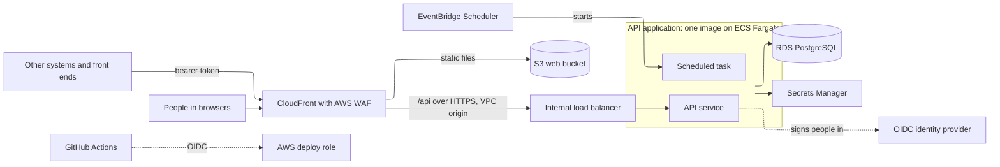

# Application template design

The architecture and development practices for applications built with AI coding assistants. Applications have a web interface, an API running in a container and a PostgreSQL database, hosted on AWS, with source code and pipelines in GitHub.

The design is held in three repositories ([ADR-0001](../adrs/0001-shape-of-the-outcomes.md)):

| Repository | Holds | An application |
|---|---|---|
| `ai-app-standard` | This design, the decisions behind it, the configuration defaults and the developer setup guide | Refers to it |
| `ai-app-template` | The specifications, repository settings and instructions for the AI coding assistant | Is created from it, then owns its copy |
| `ai-app-platform` | The platform code every application needs, released as versioned packages: the API platform, the web platform and the mock identity provider | Installs the packages at a version and keeps no copy |

Settings that vary by owner or account, rather than by design, are kept out of this design. They include the versions of languages, runtimes and the database, the permitted regions, resource tagging, log retention and the accessibility level. The template reads them as configuration, and their defaults are listed in [configuration-defaults.md](configuration-defaults.md).

## API consumers

- Every interface is a client of the API: the application's own web interface, other systems, and any separate front end built for external users.
- Features are built as API operations first, so a new interface can be added, or an existing one replaced, without changing business logic.
- API paths name the resource (`/api/v1/customers/{id}`, `/api/v1/accounts/{id}`), never the caller. Who may call each operation is set by the caller's identity and roles.
- Other systems reach the API through the application's CloudFront and AWS WAF. The API validates every token itself, so a gateway can be added later without changing the application.

## Web interface

- A React single-page app built with Vite and served as static files from S3 through CloudFront.
- The API signs people in as a backend-for-frontend, using the authorisation code flow with PKCE as a confidential client. The browser holds only an HttpOnly session cookie and never receives a token.
- One API module for every call to the API, using a client generated from the API's OpenAPI description.
- A shared component kit built on Tailwind and Radix primitives, extended rather than replaced.
- Route guards decide only what is shown. The API enforces access.
- No business rules in the web interface.
- A strict Content Security Policy set at CloudFront, allowing connections only to the application's own address.
- The environment name read from a `config.json` written at deployment, so the same build is deployed to every environment. The web interface needs no identity settings.
- Timestamps shown in the browser's time zone, in date and time formats each application sets for its users and screens.
- An environment banner on every non-production environment.
- A confirmation step before any action that cannot be undone.
- Accessible to the level in the configuration defaults, with tables that have captions and announce their sort order.

## API

- Python with FastAPI.
- Layered: routes handle HTTP and own transactions; services hold business logic with no HTTP concerns; repositories hold all database access; schemas define requests and responses.
- All business logic sits in the API, especially logic that is complex or must be applied consistently. Outcomes are calculated and stored by the API, with rule thresholds held in versioned configuration.
- Every request is validated, including value ranges.
- Timestamps are held in UTC and exchanged as ISO 8601 with an offset. Rules that depend on the local day use a configured business time zone.
- Versioned under `/api/v1`, with the generated OpenAPI document as the contract. Breaking changes need a new major version.
- One error format for every response, with an error code, details, and correlation and request IDs.
- A correlation ID carried from the browser through the API into the logs and audit records.
- Structured JSON logs with no personal information. Who acted is recorded in the audit trail, linked to the logs by the correlation ID.
- An unauthenticated `/api/health` endpoint that checks the database.

## Identity and access

- Any OpenID Connect provider, configured by its discovery URL. Entra ID is the default for internal users. An application with external users, such as customers or people from other companies, adds a second issuer, by default Entra External ID.
- Web sign-in is held in a server-side session in the database, ended after a period of inactivity or a maximum time. State-changing requests made with the session cookie carry a cross-site request forgery token.
- One application registration per issuer, as a confidential client with a certificate held in Secrets Manager. It defines the app roles. Each consumer system has its own registration.
- Permissions come from app roles in the token and are checked on every route. There is no role hierarchy.
- Internal, external and system roles are kept separate. Other systems use the client credentials flow.
- A consumer acting for an external user passes that user's own token for anything about them, and each application defines which records external users can see, checked in the API's service layer.
- Directory lookups, where an application needs them, go through the API.
- Every deployed environment validates real tokens and refuses to start without identity settings. Developers' machines use a local mock identity provider standing in for each issuer, through the same sign-in and validation code.

## Data

- PostgreSQL on Amazon RDS, with the master password managed by RDS in Secrets Manager.
- The application connects as its own least-privilege user over verified TLS. Only the migration step can change the schema.
- Schema changes are versioned migration scripts (Alembic), run by the pipeline as a one-off ECS task before each service update. An ECS task is one running copy of a container. The API runs as long-lived tasks, and migrations and scheduled jobs run as tasks that exit when they finish.
- Conventions: UUID keys, `timestamptz` timestamps in UTC, `date` for calendar dates, soft delete, JSONB for documents and check-constrained enums.
- An append-only audit trail records who changed what, with before and after state and a reason for corrections. Records that need their full history also keep a revision table. Audit records may hold personal information because they sit in the same database as the records they describe, with the same access control, encryption and retention.
- Data leaves the application only through its API or through a defined export that records each run. There is no generic data export.
- Backup retention and recovery objectives are set per environment, with a tested restore.
- Only synthetic data is held in the repository.

## AWS infrastructure

- Deployed to a region the configuration permits.
- Deployed into a VPC and subnets supplied as required inputs. The account bootstrap can create a minimal network for an account that has none.
- One CloudFront distribution as the entry point:
  - `/api/*` goes to an internal load balancer through a CloudFront VPC origin over HTTPS. The load balancer admits only CloudFront.
  - Everything else goes to a private S3 bucket through Origin Access Control.
  - AWS WAF on the distribution, including rate-based rules.
  - Hashed assets are cached for a year and HTML is revalidated on every request.
- The API runs on ECS Fargate in private subnets with no public IP addresses, with:
  - separate task and execution roles
  - a deployment circuit breaker with rollback
  - container health checks
  - at least two tasks across Availability Zones in `prod`
- Each application decides whether its database is Multi-AZ, from its availability and recovery requirements.
- Images in ECR with immutable tags and scanning on push.
- Secrets in Secrets Manager, encrypted with the configured keys and rotated on the configured schedule.
- Static secrets are injected into tasks at start-up. The API fetches its database credentials at connection time with a short cache, so a rotated password is picked up without a redeployment.
- No secret value is generated by Terraform or held in its state. RDS manages its own master password.
- Secrets are never held in `.env` files, in the repository or in pipeline variables.
- Scheduled work runs as ECS tasks started by EventBridge Scheduler from the API image. A scheduled task is the API application with a different entry point, using the same services and repositories, so it accesses the database directly rather than calling the API over HTTP. Asynchronous work uses an SQS queue and a worker service.
- Every resource carries the configured tags and is grouped in an application Resource Group.
- Defined in Terraform, one file per concern, with input validation.
- Terraform state is kept in S3 with native state locking.

## Monitoring

- Logs in CloudWatch Logs, kept for the configured retention period.
- Container Insights enabled on the ECS cluster.
- Alarms on running tasks below the desired count, high CPU and memory, load balancer 5xx responses and target response time.
- A dashboard per application.

## Delivery pipeline

- GitHub Actions, authenticating to AWS through OIDC. Deploy roles trust the repository's immutable identifier and a GitHub Environment, or its `main` branch on a plan without environments.
- A bootstrap script creates the OIDC provider, the Terraform deploy role (with a permissions boundary) and the state bucket. An operator runs it with their own single sign-on credentials.
- Every pull request runs lint, format and type checks, unit tests, integration tests against PostgreSQL, a coverage check (80% for services, 70% overall), the image build and Terraform `fmt` and `validate`. It also runs code, dependency, secret, container and infrastructure scanning.
- Each merge to `main` produces one build, which is deployed unchanged to each environment in turn, with only the configuration differing. Merging to `main` deploys it to `dev`. Test and production deployments need approval from a required reviewer where the GitHub plan provides it, and are otherwise started only by someone agreed to approve releases ([A-02](configuration-defaults.md#a-02)); either way, from `main` only.
- Infrastructure changes are planned on pull requests with a read-only role and applied from `main` through an approved environment.
- Role ARNs, region, network IDs and backend settings are repository variables, named for the environment where they differ by stage. Any sensitive value a pipeline needs is read from Secrets Manager at run time.
- Third-party actions are pinned to commit SHAs, with Dependabot proposing updates. Workflow tokens have no permissions by default and each job is granted only what it needs.
- The web build is uploaded to S3 and the CloudFront cache is invalidated.

## Repository and AI working method

- One monorepo per application: `apps/api`, `apps/web`, `infra/`, `specs/`, `adrs/`, `docs/` and `.github/workflows/`.
- The platform code is installed from `ai-app-platform` at released versions, never generated or copied into an application. A fix to it is made there and reaches applications as a new version.
- `CLAUDE.md` points the assistant at the specifications. The specifications are the source of truth for what is built, and a set of generation rules governs how code is written.
- Behaviour changes update the relevant specification in the same change.
- `.claude/settings.json` sets allowed commands and denies access to secrets files such as `.env` and `*.tfvars`. The assistant stops and reports if it finds a credential.
- Decisions are recorded as ADRs from a standard template.
- Branch rulesets, required checks, CODEOWNERS and a pull request template that asks whether specifications were updated.
- Secret scanning in the pull request checks, push protection where the GitHub plan provides it, and a secret scan before each commit on developers' machines.
- Lockfiles committed for every package, and base images pinned.
- A usage guide covers creating a repository from the template, and a runbook covers the identity provider and GitHub setup.

## Developer workstation

- Linux on Windows (WSL) with Docker Engine, running PostgreSQL, the mock identity provider and the API locally with Docker Compose. The web interface runs on the Vite development server, which proxies API calls to the local API. Native Linux or macOS with a Docker-compatible engine works the same way.
- `.env` files hold only non-secret settings and throwaway values for local containers, such as the local database password. Local development needs no real secret: sign-in uses the local mock issuer and AWS access uses the developer's own single sign-on session.
- Source code kept in the WSL Linux filesystem rather than on the Windows drive, so file watching works and access is fast.
- AWS access through IAM Identity Center single sign-on, limited to development accounts. No access keys are held on laptops, and test and production change only through the pipelines.
- One setup guide, [developer-setup.md](developer-setup.md), held in the standard rather than the template.

## Application rules

Every application follows the same rules for how it handles records, values, time, evidence, calculations, jobs, integrations and screens, whatever its domain. The template states them in full in `specs/23-application-rules.md`, and each application's own rules refer to them by ID. Each rests on the recognised source below.

| ID | Rule | Source |
|---|---|---|
| AR-01 | The system enforces a business rule on every path that writes the data, never only in a screen. | template 99-generation-rules.md ("All business logic is in the API") and template 22-domain-logic.md template rule 1 |
| AR-02 | A value the business may change is reference data or versioned configuration, never hardcoded in code, a view or a screen. | template 99-generation-rules.md ("Thresholds are configuration, not code") |
| AR-03 | Each rule, definition and calculation is implemented once and used by every path, screen, report, export, notification, job and domain that needs it, so the same data always gives the same answer. | The DRY principle (Hunt and Thomas, The Pragmatic Programmer); single source of truth; template 99-generation-rules.md (outcomes are calculated and stored by the API) |
| AR-04 | Every configuration value has a declared type and, where one applies, a stated default. | The Twelve-Factor App (configuration); fail fast (Shore, IEEE Software, 2004); template 20-api-scaffold.md (settings) |
| AR-05 | A query, validation, preview, report or export never changes stored data or the thing being checked. | Command-query separation (Meyer); safe methods (RFC 9110); template 21-api.md (explicit operations) |
| AR-06 | An operation changes only the fields it names. | Idempotent methods (RFC 9110); template 21-api.md (explicit operations) and template 99-generation-rules.md (no generic update of arbitrary fields) |
| AR-07 | An operation's result depends only on its own inputs and stored data. | The Twelve-Factor App (stateless processes); template 10-architecture.md (services are stateless) |
| AR-08 | No function is built that nothing reaches. | CWE-561 (dead code); ISO/IEC 25010 (maintainability); YAGNI |
| AR-09 | Identity and credentials belong to the identity provider. | template 10-architecture.md (identity, [ADR-0004](../adrs/0004-identity-and-authorisation-model.md)) and template 02-requirements.md (every request needs a valid sign-in session or access token); NIST SP 800-63B (Digital Identity Guidelines: authentication), which advises against routine password expiry |
| AR-10 | Access is denied unless a check positively grants it. | OWASP ASVS (access control: deny by default); OWASP Top 10 (broken access control); CWE-636 (not failing securely) |
| AR-11 | A role is a named set of permissions and grants only what it names. | The NIST role-based access control model (ANSI INCITS 359); OWASP ASVS; template 50-auth.md ("There is no hierarchy. A role grants only what it names.") |
| AR-12 | The server authorises every operation against the actor's permissions and their right over every record it touches, including both source and destination and every item of a bulk action. | Complete mediation (Saltzer and Schroeder); OWASP Top 10 (broken access control); OWASP API Security Top 10 (broken object level authorisation); template 50-auth.md ("The API enforces every permission") |
| AR-13 | Every person, system and job acts under its own identity with only the privileges its work needs. | Least privilege: NIST SP 800-53 (access control family); ISO/IEC 27001 (access control); CWE-250; template 30-data-model.md (runtime privileges) |
| AR-14 | A secret is held only in the secrets store and read at run time. | OWASP Secrets Management Cheat Sheet; CWE-798 (hard-coded credentials); CWE-532 (sensitive information in logs); template 99-generation-rules.md (secrets and data) and template 12-aws-deployment.md (secrets) |
| AR-15 | Withdrawing a person's access ends it within a stated time, including sessions already open, and a change to a person's data scope applies from their next request. | OWASP ASVS 5.0 (requirement 7.4.2, terminate sessions when an account is disabled); template 50-auth.md (session lifetime) |
| AR-16 | A record is identified by a stable key, never by its display text or a legacy code. | template 30-data-model.md (UUID primary keys) |
| AR-17 | Every reference to another record is held as a key to that record, enforced by the database. | Referential integrity in the relational model (Codd) and SQL foreign keys (ISO/IEC 9075); template 30-data-model.md (foreign key conventions) |
| AR-18 | A uniqueness, required-value, permitted-value or no-overlap rule on stored data is declared as a database constraint as well as checked by the service, so a concurrent write cannot break it. | SQL constraints (ISO/IEC 9075); CWE-367 (check-then-act race); defence in depth; template 30-data-model.md (constraint conventions) |
| AR-19 | A value, status, indicator, count or membership derived from other data is derived by one rule from the current source whenever that changes, or kept in step with it in the same operation. | Normalisation and avoiding update anomalies (Codd); template 22-domain-logic.md template rule 2 |
| AR-20 | A business operation that writes several records succeeds or fails as a whole, in one transaction or with a stated compensating step where one transaction cannot cover the work. | ACID transaction properties; the Unit of Work pattern (Fowler); the Saga pattern for compensating steps; template 99-generation-rules.md (routes own the transaction) |
| AR-21 | When two people change the same record, a change made from an out-of-date copy of it is refused and reported. | template 30-data-model.md (a version column for optimistic locking) and template 22-domain-logic.md template rule 5 (concurrency) |
| AR-22 | Deleting a business record is a soft delete. | template 30-data-model.md ("Audited records are not hard-deleted") and template 31-audit.md |
| AR-23 | A record that others depend on is never removed. | Referential integrity in the relational model (Codd); reference data management (DAMA-DMBOK); template 30-data-model.md (soft delete) |
| AR-24 | A rule that picks one record (the latest, the earliest or the next) uses an explicit order with a tie-break, and any row limit applies after ordering. | ISO/IEC 9075 (row order is undefined without an explicit order) |
| AR-25 | A hierarchy of records admits no cycle, and a parent is of the type the hierarchy allows. | DAMA-DMBOK, 2nd edition (hierarchy management in reference and master data); referential integrity in the relational model (Codd) |
| AR-26 | A fact owned by another corporate system of record is maintained only there. | System of record in master and reference data management (DAMA-DMBOK, 2nd edition) |
| AR-27 | The database schema is defined only by versioned migrations in source control, and only the migration step changes it (template 30-data-model.md). | Evolutionary database design (Ambler and Sadalage); template 30-data-model.md (migrations) |
| AR-28 | Each value is held in its own data type: a number as a number, a date or time as a date or time, a yes-or-no value as a boolean and a coded value as a key to reference data. | template 30-data-model.md (timestamps, calendar dates and enumerations each in their own type) |
| AR-29 | A value's type, length and format are set by what the value is: its business definition, a standard, or the system or regulator that defines it. | Data management practice: a value's constraints come from its business definition or a standard (DAMA-DMBOK) |
| AR-30 | A query or command never contains input as text. | OWASP Top 10 (injection); CWE-89; OWASP Query Parameterization Cheat Sheet |
| AR-31 | A value is stored as given or refused with the reason, and is never truncated, replaced or discarded without telling the user. | OWASP Input Validation Cheat Sheet (reject rather than alter invalid input); CWE-197 (numeric truncation error); ALCOA+ (original) |
| AR-32 | Input is validated against what is permitted. | OWASP ASVS (validation); OWASP Input Validation Cheat Sheet; the Notification pattern (Fowler); template 21-api.md (validation and error response) |
| AR-33 | Values are compared, sorted and calculated in their own type, never through their text, and no result depends on a session's language, date format or number format. | CWE-1024 (comparison of incompatible types); ISO 8601; W3C Internationalization (locale-neutral processing) |
| AR-34 | A comparison, filter, join or change test treats an absent value as its rule states. | ISO/IEC 9075 (comparison with an absent value is unknown; IS DISTINCT FROM) |
| AR-35 | A quantity is held and shown with its unit, and converted between units only through one maintained conversion for each pair of units. | The SI Brochure (BIPM); ISO 80000-1 (quantities and units); Unified Code for Units of Measure (UCUM) |
| AR-36 | A value that changes over time is held with the date it takes effect, its periods do not overlap, and it changes by closing one period and opening the next rather than by overwriting. | Fowler's temporal patterns (Effectivity, Temporal Property); SQL:2011 application-time periods (ISO/IEC 9075) |
| AR-37 | A period of calendar dates includes the whole of its first and last day, judged in the business time zone. | ISO 8601 (dates and time intervals); SQL:2011 application-time periods; Fowler's Range pattern; template 99-generation-rules.md (UTC and the business time zone) |
| AR-38 | A period over date and time includes its start instant and excludes its end instant, so consecutive periods such as days, months and report windows partition time and each event falls in exactly one. | SQL:2011 application-time periods (ISO/IEC 9075-2), which are closed-open; ISO 8601-1:2019 (time intervals) |
| AR-39 | Business days are counted against one maintained calendar of working days and public holidays in the business time zone, used by every rule and report that counts business days. | DAMA-DMBOK (reference data management); template 20-api-scaffold.md (business time zone) |
| AR-40 | The server records who acted and when on every record and audit entry, from the authenticated session and the server clock in UTC. | NIST SP 800-53 (audit and accountability family); the ALCOA+ data integrity principles (attributable, contemporaneous); template 31-audit.md (audit record fields) |
| AR-41 | Every change to business data, reference data and access is audited with its before and after state, including setting or clearing a value and changes to a record's notes. | NIST SP 800-53 (protection of audit information); ISO/IEC 27001 (logging); ALCOA+ (enduring); template 31-audit.md (what is audited, immutability) |
| AR-42 | An outcome records what decided it, such as the threshold applied and the configuration version, and later displays and notifications read that record rather than looking the inputs up again. | ALCOA+ (attributable, complete); template 99-generation-rules.md (an outcome is stored with its configuration version) |
| AR-43 | Each recorded value states how it arose (observed, entered, loaded from a named source or derived) in its own attribute, and a derived value identifies the rule version and inputs that produced it. | W3C PROV-DM (provenance); ALCOA+ (attributable, original); DAMA-DMBOK (data lineage) |
| AR-44 | Every business record has a retention period set by the applicable records disposal authority. | ISO 15489-1 (records management); DAMA-DMBOK (data lifecycle); template 30-data-model.md (retention and disposal) |
| AR-45 | A failure is reported and recorded. | template 22-domain-logic.md template rule 4 (services raise domain exceptions); CWE-390 (detection of error condition without action) |
| AR-46 | Each calculation states its valid inputs and its result for every edge case, such as a zero divisor, an absent or non-numeric operand or a physically impossible result. | CWE-369 (divide by zero); CWE-682 (incorrect calculation); template 22-domain-logic.md (rule inputs and parameter ranges) |
| AR-47 | A formula a person defines is held in a defined expression language, with its operands as references to records. | OWASP Top 10 (injection); CWE-94 and CWE-95 (code and eval injection) |
| AR-48 | Each calculated figure states its precision and rounding method, and rounding is applied once, to the final figure. | ISO 80000-1 (rounding of numbers); IEEE 754 (rounding attributes) |
| AR-49 | Values from different sources are matched by key, such as date and location, never by position or label. | The relational model (Codd): rows are addressed by key, not by position |
| AR-50 | A count or total states its grain and counts each item exactly once at that grain. | Declaring the grain in dimensional modelling (Kimball) |
| AR-51 | Each figure states whether it can be added across periods, places or records. | Additive, semi-additive and non-additive facts in dimensional modelling (Kimball and Ross, *The Data Warehouse Toolkit*) |
| AR-52 | Each summary statistic, such as a mean, median, minimum, maximum or percentile, is computed by its standard definition over the values its rule names, and the output names the statistic and the period it covers. | ISO 3534-1:2006 (statistics: vocabulary and symbols); NIST/SEMATECH e-Handbook of Statistical Methods (measures of location) |
| AR-53 | Diagnostic output goes to the application log, never into business data or a business transaction, so it cannot fail or roll back a change. | OWASP Logging Cheat Sheet; the Twelve-Factor App (logs); CWE-532; template 20-api-scaffold.md (logging) |
| AR-54 | An operation that may be repeated, by a retry, a re-run or a second request, has the effect of doing it once. | Idempotency (RFC 9110); the AWS Well-Architected Framework, reliability pillar |
| AR-55 | A scheduled or background job, or any run over several items that a person starts, treats each item as its own unit of work. | The AWS Well-Architected Framework, reliability pillar; Enterprise Integration Patterns (dead letter channel); template 12-aws-deployment.md (scheduled jobs) |
| AR-56 | Every scheduled job and interface run keeps a run record: when it started and ended, what it took in, how many items it handled and each item's outcome. | AWS Well-Architected Framework, operational excellence pillar; ISO/IEC 27001 (logging); template 12-aws-deployment.md (scheduled jobs) |
| AR-57 | Each external interface has a documented, versioned contract that states its format, fields, permitted values and how each record identifies what it refers to. | Enterprise Integration Patterns (invalid message channel, dead letter channel); contract-first design (OpenAPI, AsyncAPI) |
| AR-58 | A retry is limited in number and spaced out, and reaching the limit is reported as a failure. | AWS Well-Architected Framework, reliability pillar (limited retries with backoff); Nygard, Release It! |
| AR-59 | Data exchanged with another system travels over an authenticated, encrypted channel under the system's own managed identity. | ISO/IEC 27001 (information transfer, cryptography); OWASP ASVS (communications) |
| AR-60 | Outbound data is kept until its consumer acknowledges it, and a receiver handles a repeated delivery once. | Enterprise Integration Patterns (guaranteed delivery, idempotent receiver) |
| AR-61 | Development, test and production are separate. | ISO/IEC 27001 (separation of development, test and production environments); template 12-aws-deployment.md (environments) |
| AR-62 | An inbound file is reconciled against its control totals, so the records received equal those accepted, rejected and failed. | ISACA COBIT (application input controls, completeness); DAMA-DMBOK (data quality controls) |
| AR-63 | An inbound interface changes only the data its contract says it supplies. | DAMA-DMBOK (master data management, system of record) |
| AR-64 | Every field that a publication path can send outside the organisation is classified as public or internal. | ISO/IEC 27001:2022 Annex A, controls 5.12 (classification of information), 5.13 (labelling of information) and 5.14 (information transfer) |
| AR-65 | Every option, filter and criterion offered takes effect, and every message states the rule actually applied. | ISO 9241-110 (conformity with user expectations, self-descriptiveness); Nielsen's usability heuristics |
| AR-66 | An action that cannot be undone states what it will do, including the dependent records it affects, and asks for confirmation. | ISO 9241-110 (error tolerance); template 40-ui.md (confirmation) |
