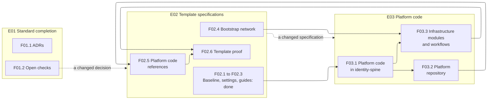

# Work plan

## Context

This plan covers the work that completes the AI application standard and the template that implements it, and builds the shared platform code applications use. Like the rest of [work/](./), it is a working document rather than part of the standard.

| Artefact | What it is | Where it is |
|---|---|---|
| AI application standard | The architecture, decisions and development process for applications built with AI coding assistants | This repository: [docs/](../docs/) and [adrs/](../adrs/) |
| AI application template | The specifications every application starts from. An application is created from it and then owns its copy. | The `ai-app-template` repository |
| Platform code | The code every application needs, such as settings, logging, sign-in and sessions, the mock identity provider, the web shell, Terraform modules and reusable workflows. Built first inside the first application, then extracted into shared, versioned packages ([D-01](../docs/decision-register.md#d-01-shape-of-the-outcomes)). | `identity-spine` first; a platform repository later |
| identity-spine | An existing application being rearchitected to the standard. It is the first application to build the platform code. | The `identity-spine` repository, with its delivery plan in `docs/delivery/` |

## How the plan is structured

The plan uses the same work-breakdown hierarchy as an application's delivery plan, defined in the template's `docs/delivery/README.md`:

| Level | Where it is described |
|---|---|
| Outcome | [Outcome](#outcome) below |
| Epic | One folder per Epic, with its `README.md` |
| Feature | A file in its Epic's folder once it is near; a summary in the Epic file until then |
| Story | In its Feature file |
| Task | In its Feature file |

Detail follows distance:

| Horizon | Work | Detail held |
|---|---|---|
| Now | The ADRs, the open checks, the bootstrap network and the platform code in identity-spine | A Feature file with Stories and Tasks |
| Next | What follows once identity-spine runs on the platform code | A Feature summary with outline acceptance criteria, in the Epic file |
| Later | Everything beyond | One line per Feature, in the Epic file |

IDs are Epic `E01`, Feature `F01.1` and Story `S01.1.1`. identity-spine's plan uses IDs of the same form, so a reference to its items always names it, as in "identity-spine F03.1". Each Story records the decisions it builds on, so it can be rechecked if they change.

The [tracker](tracker.md) records the status of every Epic, Feature and Story, and each item's GitHub issue where it has one. The plan files describe the work and are not updated as it progresses.

## Outcome

**Applications built with AI coding assistants start from one standard and share tested platform code.**

| Field | Content |
|---|---|
| Why | Without a standard, each application decides its architecture again. Without shared code, every application generates its own sign-in, secrets handling and audit, and their quality varies from one application to the next. |
| Hypothesis | A standard, a template of specifications and shared, versioned platform code let an application generate only its own business code, while the security-critical code stays the same across applications |
| Benefits | Decisions made and recorded once; platform fixes reach every application through an upgrade; a faster start for each new application |
| Measurable results | Every decision recorded as an ADR; applications consuming the platform code by version; the time from creating a repository from the template to an application's first local release |

## Epics

| Epic | Type | Pitch |
|---|---|---|
| [E01 Standard completion](e01-standard-completion/README.md) | Enabler | Every decision recorded as an ADR, and the checks the decisions still depend on made |
| [E02 Template specifications](e02-template-specifications/README.md) | Enabler | The template's specifications, repository settings and guides completed, pointed at the platform code and proven by a new application |
| [E03 Platform code](e03-platform-code/README.md) | Enabler | The code every application needs, built once in identity-spine from the template's specifications, then extracted and released by version |

## Sequence

E01 runs alongside the others. When a check changes a decision, the template specifications are changed first, and the platform code follows.

## Decisions needed

| # | Decision | Why it matters | Needed by | Recommendation |
|---|---|---|---|---|
| 1 | When is the platform code extracted from identity-spine into its own repository? | Extracting too early builds packages around one application's needs; too late and a second application copies the code instead | F03.2 | **Decided 2026-11-08:** now, after identity-spine F01.12 settled the module boundaries, rather than when a second application starts. identity-spine's Epic E01 standardises its architecture, which includes consuming the platform code as packages (its F01.11 and F01.13). The risk of packages shaped around one application is met by F01.12, the template specifications the packages are tested against, and the packages' own tests. The repository is `ai-app-platform`, private |
| 2 | Should identity-spine be deployed to AWS as the template proof, or a new application created from the template? | identity-spine was not created from the template, so it does not test `TEMPLATE_USAGE.md` | F02.6 | A small new application created from the template, deployed end to end |
| 3 | How do the platform's tables (`auth_sessions`, `audit_records`) reach an application's database? | The package defines them, but each application has its own Alembic history, and identity-spine's already creates them | F03.2 S03.2.2 | **Decided 2026-11-08:** the application owns all its migrations. The package ships its models, and a new application's first migration creates the platform's tables from a migration the package documents. identity-spine's history is unchanged; it may later be replaced by a single baseline before its first AWS deployment, as identity-spine's own decision |
| 4 | How do an application's machines and pipelines install packages from the private `ai-app-platform`? | GitHub's per-run token cannot read another private repository's code, which uv needs to install the API platform from a git tag; npm packages and images in GitHub Packages can grant a repository's runs access instead | F03.2 S03.2.5 | **Decided 2026-11-08:** `ai-app-standard`, `ai-app-template` and `ai-app-platform` are public, under the Apache License 2.0; applications such as identity-spine may stay private. The API platform then installs from a public git tag and the mock identity provider image pulls anonymously, with no credential. The web platform is published to GitHub Packages, whose npm registry needs a token even for public packages: an application's pipelines use their own run token with `packages: read`, and a developer a token with `read:packages`. No GitHub secret is added. Each repository's history was scanned for secrets first, with none found |

## Dependencies

| Dependency | Needed by |
|---|---|
| identity-spine's rearchitecture, as the first application to build the platform code | F03.1 |
| An AWS account, a domain for the load balancer certificate and an identity provider tenant | F02.6, F03.3 applied |

## Risks

| Risk | Mitigation |
|---|---|
| The platform code takes the shape of identity-spine's needs | The platform code implements the template specifications, in modules kept separate from identity-spine's domain code. Code specific to identity-spine stays out of them. |
| AWS running costs while proving the template | Deploy only `dev`, and destroy it through the pipeline when the proof is done |
